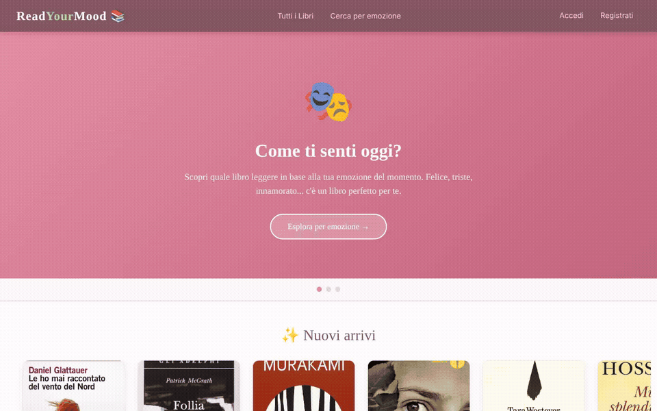
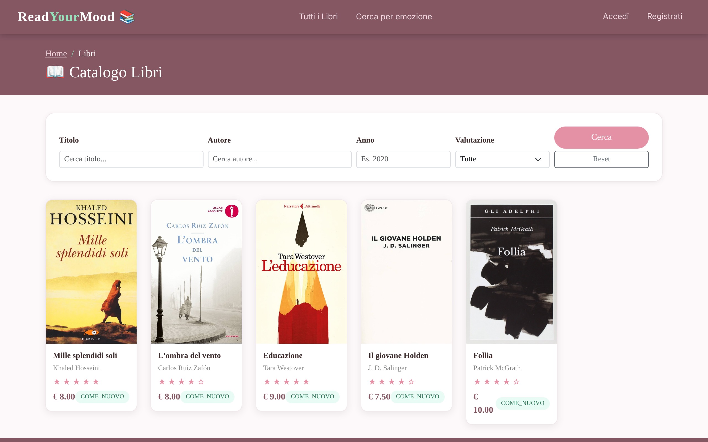
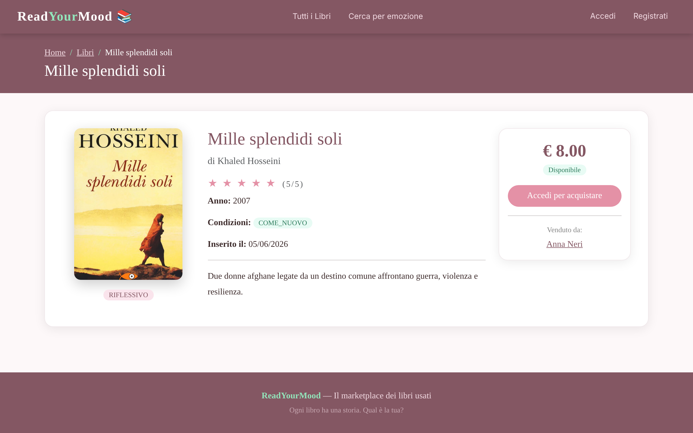
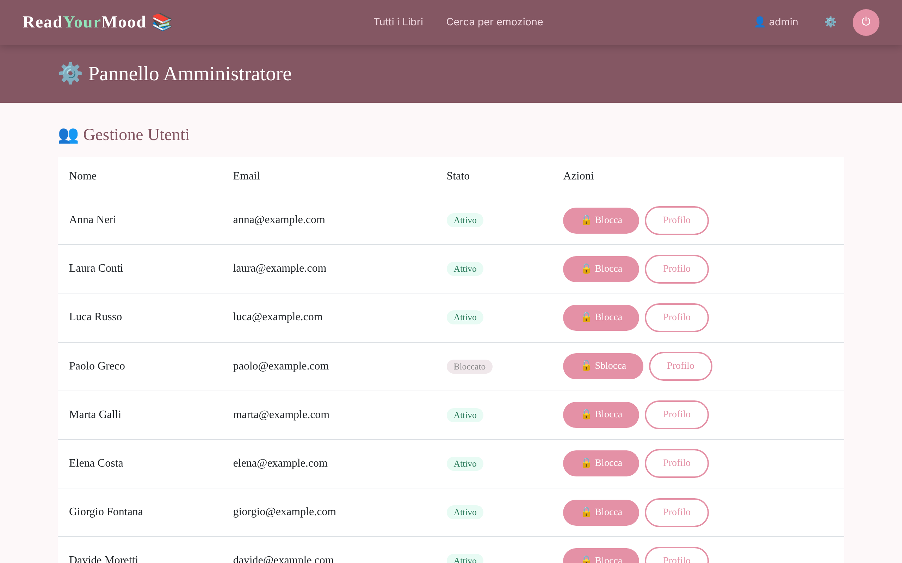

# ReadYourMood

[](#readyourmood--italiano)

**A second-hand book marketplace where you can browse books by the mood they evoke.** Built with Spring Boot, PostgreSQL and Thymeleaf, plus a small React catalog page that reads a REST endpoint. University project for *Sistemi Informativi su Web* (Roma Tre University, 2026), developed in a team of two.



▶️ **[Full walkthrough video (3 min)](docs/demo-full.mp4)**: guest, registered user (sell, buy, create a set, review), blocked user, admin, React page and Swagger.

## Features

- **Browse by mood**: every book is tagged with one of 8 emotions (happy, sad, in love, reflective, anxious, nostalgic, angry, scared).
- **Catalog with filters** by title, author, year and rating, with pagination.
- **Sell a book**: registered users list their books with condition, price and a cover image (upload up to 5 MB).
- **Buy**: purchase a single book or a set of books from the same seller; purchased books are marked as sold.
- **Seller reviews**: after an order, the buyer can rate and review the seller.
- **Personal area** with the user's books and orders, and a public seller profile.
- **Admin panel**: block and unblock users. Blocked users cannot log in, and their books cannot be bought.
- **React catalog page** that loads books from `GET /rest/libri` and filters them client-side.

| Browse by mood | Book detail |
|---|---|
|  |  |
| **Admin panel** | **React catalog** |
|  |  |

## Tech stack

| Layer | Technologies |
|---|---|
| Backend | Java 17, Spring Boot 3.0 (Web MVC, Data JPA, Security, Validation), Hibernate |
| Database | PostgreSQL |
| Server-side UI | Thymeleaf, Bootstrap 5 |
| Frontend (catalog page) | React 19, TypeScript, Vite, Material UI, Axios |
| API docs | springdoc-openapi (Swagger UI) |
| Tooling | Maven, Docker Compose, JUnit 5, Mockito |

## Architecture

```
Browser ──► Thymeleaf pages (Spring MVC controllers)  ─┐
                                                       ├─► Services ─► JPA repositories ─► PostgreSQL
React page (Vite) ──► GET /rest/libri (REST controller)┘
```

- **Most of the application is server-side rendered**: Spring MVC controllers return Thymeleaf views for catalog, book pages, orders, reviews, personal area and admin panel.
- **One REST endpoint** (`GET /rest/libri`, read-only) feeds the React catalog page.
- **Layered backend**: `controller` → `service` (business rules, e.g. only the seller can edit a book, sold books cannot be edited) → `repository` (Spring Data JPA) → `model` (JPA entities: `Libro`, `Utente`, `Credenziali`, `Ordine`, `Recensione`).
- **Security**: Spring Security with form login and server-side sessions, BCrypt-hashed passwords, two roles (`ADMIN`, `USER`).

## My role

Team of two. Split of the original course work:

- **Me**: JPA entities and repositories, MVC controllers and the REST controller (with CORS configuration), React frontend.
- **My teammate**: Spring Security configuration, service layer, cover image upload, registration and personal area logic.
- **Together**: Thymeleaf views, sample data, Swagger setup.

After the course (2026) I prepared the project for publication on my own: sample database without personal data, Docker Compose setup, unit tests for the order and book services, public Swagger UI, bug fixes and this README.

## Quick start (Docker)

Requirements: [Docker Desktop](https://www.docker.com/products/docker-desktop/).

```bash
git clone https://github.com/sarabaranes-dev/ReadYourMood.git
cd ReadYourMood
docker compose up --build
```

On the first start PostgreSQL loads the sample data from `db/seed.sql` (16 books, 9 users, orders and reviews). When the log shows `Started SiwLibro01Application`:

- App: http://localhost:8081
- Swagger UI: http://localhost:8081/swagger-ui/index.html

Stop with `Ctrl+C`, then `docker compose down` (add `-v` to also delete the database and reload the sample data next time).

> Port 5432 must be free: stop any local PostgreSQL first.

### Demo accounts

All demo accounts use the password `password`.

| Username | Role | Notes |
|---|---|---|
| `admin` | ADMIN | access to the admin panel |
| `luca` | USER | regular user with books for sale |
| `paolo` | USER | blocked user |

You can also register a new account (it gets the `USER` role).

## Run without Docker

Requirements: Java 17, PostgreSQL, Node.js 18+.

1. Create an empty database and load the sample data **before the first start** of the backend:
   ```bash
   createdb books
   psql -d books -f db/seed.sql
   ```
2. Start the backend (default credentials `postgres`/`postgres`; override with `DB_USERNAME` and `DB_PASSWORD`):
   ```bash
   cd siw-libro-01
   ./mvnw spring-boot:run
   ```
3. Optional, the React catalog page (needs the backend on port 8081):
   ```bash
   cd siw-libri-react
   npm install
   npm run dev
   ```
   It runs on http://localhost:5174.

## Tests

```bash
cd siw-libro-01
./mvnw test -Dtest='*ServiceTest'
```

7 unit tests (JUnit 5 + Mockito, no database needed) cover the main business rules: creating an order marks books as sold and computes the total; mood search returns only available books; only the seller can edit a book, and sold books cannot be edited. `./mvnw test` also runs a Spring context test, which needs PostgreSQL running.

## Known limitations

- The React frontend covers only the catalog page; the rest of the UI is Thymeleaf. The REST API is a single read-only endpoint, and the React page also lists books that are already sold.
- Payments are not implemented: an order is marked as completed immediately.
- Cover images are stored on the local filesystem (`siw-libro-01/uploads/`).
- The schema is managed by Hibernate (`ddl-auto=update`), without migrations.
- Tests cover two services only; there are no controller or end-to-end tests.
- The UI is in Italian.

---

# ReadYourMood — Italiano

**Un marketplace di libri usati in cui si possono cercare i libri in base all'emozione che trasmettono.** Realizzato con Spring Boot, PostgreSQL e Thymeleaf, più una piccola pagina catalogo in React che legge un endpoint REST. Progetto universitario per *Sistemi Informativi su Web* (Università Roma Tre, 2026), sviluppato in un team di due persone.

▶️ **[Video completo (3 min)](docs/demo-full.mp4)**: ospite, utente registrato, utente bloccato, admin, pagina React e Swagger.

## Funzionalità

- **Ricerca per emozione**: ogni libro ha una di 8 emozioni (felice, triste, innamorato, riflessivo, ansioso, nostalgico, arrabbiato, spaventato).
- **Catalogo con filtri** per titolo, autore, anno e valutazione, con paginazione.
- **Vendita**: gli utenti registrati mettono in vendita i loro libri con condizione, prezzo e copertina (upload fino a 5 MB).
- **Acquisto** di un singolo libro o di un set di libri dello stesso venditore; i libri acquistati risultano venduti.
- **Recensioni al venditore** dopo un ordine.
- **Area personale** con libri e ordini dell'utente, e profilo pubblico del venditore.
- **Pannello admin**: blocco e sblocco degli utenti. Un utente bloccato non può accedere e i suoi libri non si possono acquistare.
- **Pagina catalogo in React** che carica i libri da `GET /rest/libri` e li filtra lato client.

## Architettura

- **La maggior parte dell'applicazione è renderizzata lato server**: i controller Spring MVC restituiscono viste Thymeleaf.
- **Un solo endpoint REST** (`GET /rest/libri`, in sola lettura) alimenta la pagina React.
- **Backend a livelli**: `controller` → `service` (regole di business) → `repository` (Spring Data JPA) → `model` (entità JPA).
- **Sicurezza**: Spring Security con form login e sessione, password cifrate con BCrypt, due ruoli (`ADMIN`, `USER`).

## Il mio ruolo

Team di due persone. Divisione del lavoro durante il corso:

- **Io**: entità JPA e repository, controller MVC e controller REST (con configurazione CORS), frontend React.
- **La mia collega**: configurazione di Spring Security, livello service, upload delle copertine, registrazione e area personale.
- **Insieme**: viste Thymeleaf, dati di esempio, configurazione di Swagger.

Dopo il corso (2026) ho preparato da sola il progetto per la pubblicazione: database di esempio senza dati personali, Docker Compose, test unitari sui servizi di ordini e libri, Swagger pubblico, correzione di bug e questo README.

## Avvio rapido (Docker)

```bash
git clone https://github.com/sarabaranes-dev/ReadYourMood.git
cd ReadYourMood
docker compose up --build
```

Al primo avvio PostgreSQL carica i dati di esempio da `db/seed.sql`. App su http://localhost:8081, Swagger su http://localhost:8081/swagger-ui/index.html. Account demo: `admin`, `luca`, `paolo` (bloccato), tutti con password `password`. La porta 5432 deve essere libera.

Per l'avvio senza Docker e per i test valgono i comandi della sezione inglese.

## Limiti noti

- React copre solo la pagina catalogo; il resto dell'interfaccia è in Thymeleaf. L'API REST è un solo endpoint in sola lettura, e la pagina React mostra anche i libri già venduti.
- I pagamenti non sono implementati: un ordine risulta completato subito.
- Le copertine sono salvate sul filesystem locale.
- Lo schema è gestito da Hibernate (`ddl-auto=update`), senza migrazioni.
- I test coprono solo due service; non ci sono test sui controller né end-to-end.
